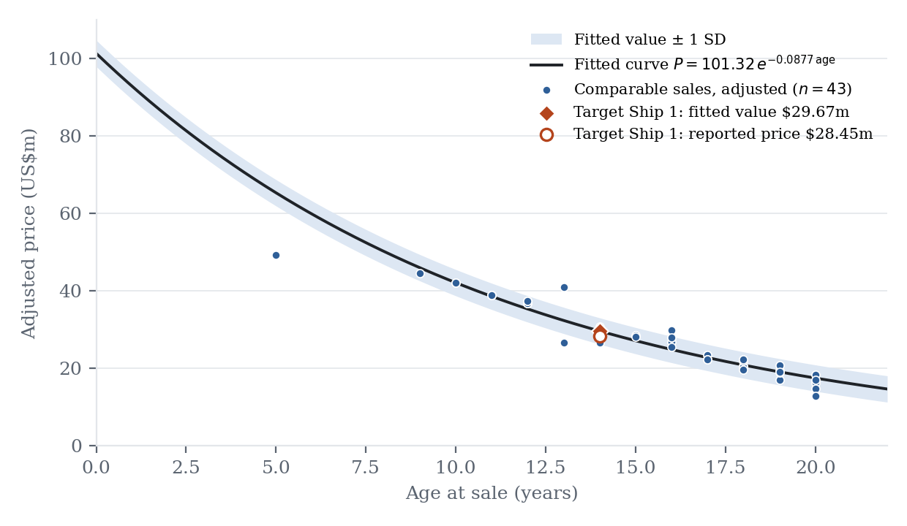
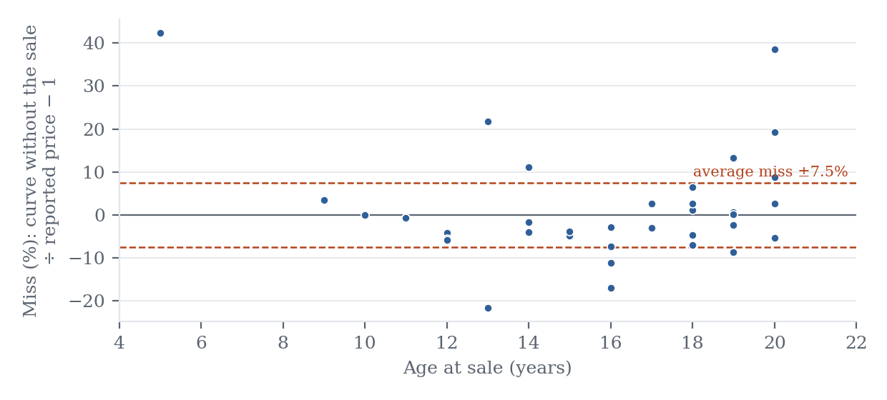

# Vessel Age Curve (M1)

**Valuing a second-hand ship from comparable sales.** Recent sales of similar ships, reported on or before the valuation date, are moved to that date with a broker price benchmark, an exponential depreciation curve is fitted to price against age by OLS on log price, and the ship is read off the curve at its own age.

📄 **[Technical note (PDF)](M1_Age_Curve_Technical_Note.pdf)** – full derivation, application, back-test, limitations and references.

## Model

$$\ln P_i = c + b\,\mathrm{age}_i + \varepsilon_i \qquad\Longrightarrow\qquad P = a\,r^{\,\mathrm{age}},\quad a = e^{c},\ r = e^{b}$$

$r$ is the share of value a ship one year older keeps; $1 - r$ is the value lost per year of age.

## Case: Target Ship 1 (MR product tanker, built 2012), 22 May 2026





| Result | Value |
|---|---:|
| Comparable sales (reported 16 Dec 2025 – 22 May 2026) | 43 |
| Value lost per year of age | 8.4% |
| Fit ($R^2$ on log price) | 0.911 |
| **Market value** | **US\$29.67m** |
| Range (± 1 SD) | US\$26.27m – 33.06m |
| Reported sale price | US\$28.45m (−4.1%, inside range) |
| Back-test, leave one out: average absolute error | 7.5% |
| Back-test, leave one out: bias | +0.8% |

## Repository

| Path | Contents |
|---|---|
| [`docs/`](.) | Technical note (LaTeX source and PDF) and its figures |
| [`data/sample/comparables.csv`](../data/sample/comparables.csv) | The 43 comparable sales: age and date-adjusted price (anonymised) |
| [`src/vessel_valuation/data/load.py`](../src/vessel_valuation/data/load.py) | Reads and checks the comparables file |
| [`src/vessel_valuation/models/age_curve.py`](../src/vessel_valuation/models/age_curve.py) | The model: fits the curve by OLS on log price; value and range at any age |
| [`src/vessel_valuation/analytics/backtest.py`](../src/vessel_valuation/analytics/backtest.py) | Leave-one-out back-test: average miss and bias |
| [`src/vessel_valuation/reporting/figures.py`](../src/vessel_valuation/reporting/figures.py) | The age-curve and back-test charts |
| [`examples/run_age_curve.py`](../examples/run_age_curve.py) | One run: values Target Ship 1, runs the back-test, draws the figures |
| [`tests/test_age_curve.py`](../tests/test_age_curve.py) | Checks the published results and that bad input is refused |
| [`requirements.txt`](../requirements.txt) | The add-ons the code needs |

## Run

```bash
python3 -m pip install -r requirements.txt
python3 examples/run_age_curve.py
python3 -m unittest discover -s tests
```

## Related

**M1+ Hedonic regression** (in preparation) adds size, yard, survey timing, scrubber and market level to the age curve.

---

*Author: Yan Li. Data from weekly broker sale-and-purchase reports, anonymised; prices adjusted to 22 May 2026. Version 1.1 (12 Nov 2026) uses only sales reported by the valuation date; version 1.0 had used 30 sales, four of them reported later.*
