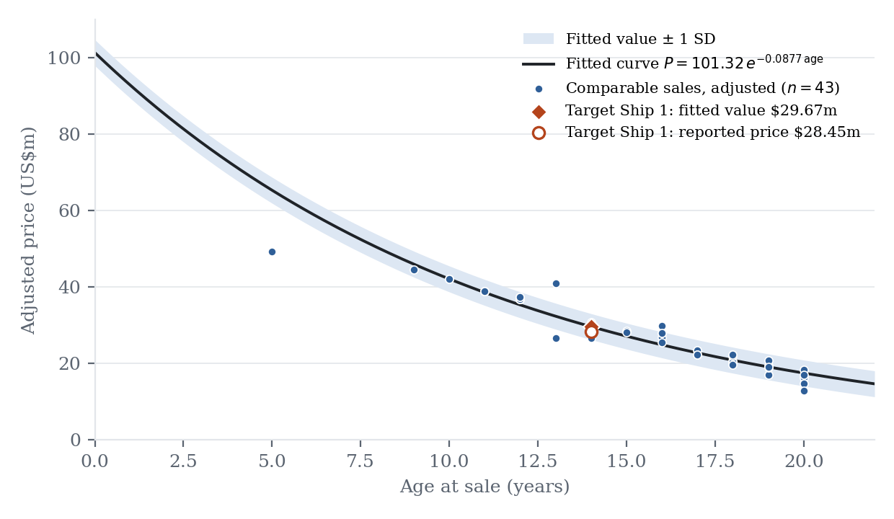

# Shipping Vessel Valuation

A Python research project for developing, validating and comparing
vessel valuation methods.

## Project status

Work in progress. The first model, the **M1 vessel age curve**, is published with its code, anonymised data, tests and technical note.

## Models

| Model | Question it answers | Status |
|---|---|---|
| [M1 Vessel age curve](docs/M1_age_curve.md) | What is a second-hand ship worth, from recent sales of similar ships? | Published |
| M1+ Hedonic regression | How do size, yard, survey timing and scrubbers move the price beyond age? | In preparation |
| Discounted cash flow and others | What is the ship worth from the cash it can earn? | Planned |

## M1 headline result



Target Ship 1, an MR product tanker built in 2012, valued on **22 May 2026** using only the 43 comparable sales reported on or before that date:

| Result | Value |
|---|---:|
| **Market value** | **US\$29.67m** (range US\$26.27m – 33.06m) |
| Value lost per year of age | 8.4% |
| Reported sale price | US\$28.45m: 4.1% below the curve, inside the range |
| Leave-one-out back-test | average miss 7.5%, bias +0.8% |

The Python results agree with an independent Excel implementation of the model to 9 decimal places.

📄 [M1 page](docs/M1_age_curve.md) · [Technical note (PDF)](docs/M1_Age_Curve_Technical_Note.pdf)

## Research standards

- Traceable data and clearly stated assumptions.
- Reproducible calculations and automated tests.
- Validation that respects information availability: a valuation uses only data published on or before its date.
- Clear explanations of uncertainty and investment relevance.
- Data shared here is anonymised; broker data and ship names are not published.

## Run

```bash
python3 -m pip install -r requirements.txt
python3 examples/run_age_curve.py
python3 -m unittest discover -s tests
```

## Structure

- src/vessel_valuation/data/ — Data-processing code.
- src/vessel_valuation/models/ — Valuation models.
- src/vessel_valuation/analytics/ — Validation and sensitivity analysis.
- src/vessel_valuation/reporting/ — Report and chart generation.
- data/sample/ — Anonymised example data.
- docs/ — Methodology and research reports.
- notebooks/ — Exploratory analysis.
- examples/ — Reproducible demonstrations.
- tests/ — Automated calculation and data checks.

---

*Author: Yan Li. Personal portfolio project.*
