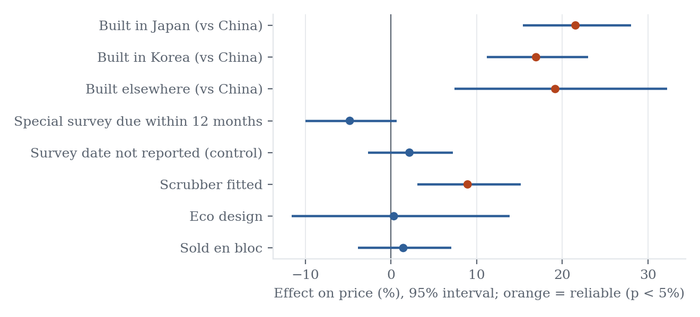
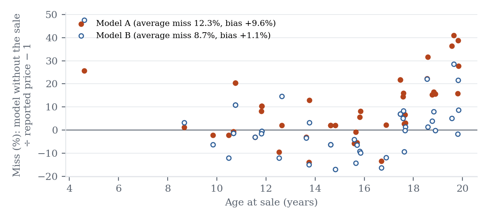

# Hedonic Ship Price Model (M1+)

**Which features drive second-hand ship prices, and by how much.** M1 values a ship from its age alone. M1+ explains the log of the sale price by age, size, yard country, survey timing, scrubber, eco design, en bloc sale and the market level, all at once, by ordinary least squares. The dataset is described as containing sales reported on or before 22 May 2026. Report dates are not included in the published CSV, so that cutoff cannot be independently verified from this file.

📄 **[Technical note (PDF)](M1plus_Hedonic_Technical_Note.pdf)** – specification, estimation step by step, valuation, leave-one-out validation, limitations and references.

## Model

$$\ln P_i = \beta_0 + \sum_k \beta_k x_{ik} + \varepsilon_i$$

A yes/no feature changes the price by $e^{\beta}-1$; for $\ln(\text{dwt})$, $\beta$ is the % change in price for 1% more deadweight. Coefficients come from $\hat\beta = (X'X)^{-1}X'y$ (checked by hand against the library), with robust (HC1) standard errors. Prices are taken back from logs with Duan's smearing factor.

| | Sales | Market level | Purpose |
|---|---:|---|---|
| Model A | 297 tankers and bulkers | ship type × quarter | Measure the feature effects |
| Model B | 45 MR tankers | quarter | Check on the target's own segment |

## What moves the price (model A)



| Feature | Effect on price | Reliable |
|---|---:|:---:|
| Built in Japan (vs China) | +21.5% | Yes |
| Built in Korea (vs China) | +16.9% | Yes |
| Scrubber fitted | +8.9% | Yes |
| Special survey due within 12 months | −4.8% | Weak |
| 1% more deadweight (tankers, total) | +0.58% | Yes |
| Value lost per year of age (tankers, total) | 7.5% | Yes |

Tankers have their own age and size slopes in model A, so the tanker rows are totals: base slope + tanker extra, with the standard error from both. In model B (MR only) the size effect comes out **negative** (−0.33% per 1% DWT, p = 0.33). A bigger ship cannot be worth less, so this number is marked *wrong sign* and not relied on: within the narrow MR band, size barely varies and the data cannot measure it.

## Case: Target Ship 1 (MR product tanker, built 2012 in Korea), 22 May 2026

| | Model A | Model B | M1 age curve |
|---|---:|---:|---:|
| **Value** | **US\$29.22m** | US\$26.29m | US\$29.67m |
| 68% range | 24.63 – 34.68 | 23.68 – 29.20 | 26.78 – 32.87 |
| Reported sale US\$28.45m vs value | −2.6% | +8.2% | −4.1% |
| Leave-one-out validation: sales tested | 45 MR sales | 45 MR sales | 43 date-adjusted comparables |
| Leave-one-out validation: average miss | 12.3% | 8.7% | 7.5% |
| Leave-one-out validation: bias | +9.6% | +1.1% | +0.8% |

M1 records a 7.5% average absolute percentage error on 43 date-adjusted comparables. Models A and B record 12.3% and 8.7% on 45 MR sales. Because the samples and price treatment differ, these results do not establish which model performs best.

Leave-one-out validation fits the model on all other sales in the collected sample and predicts the omitted sale. Training may include sales reported after the omitted transaction, so this is not a historical forecasting test.



**Reading.** Model A measures what moves prices precisely, but pooling all tankers and bulkers makes it lean high on MR tankers. Model B is unbiased but has too few sales for precise effects. Which model values MR tankers best is not yet established: that needs all models scored on the same sales with the same price treatment. Most M1 comparables are Korean-built, so the Korea premium is already in the curve; Target Ship 1's special survey, due within a year, is one *possible* reason it sold about 4% below the curve. It remains a hypothesis: the survey effect is weak (−4.8%, p = 0.08) and not reliable in model B.

## Files

| Path | Contents |
|---|---|
| [`data/sample/hedonic_sales.csv`](../../data/sample/hedonic_sales.csv) | 297 anonymised sales (H001–H297): type, age, size, yard country, features, quarter, price |
| [`src/shipping_valuation/models/hedonic.py`](../../src/shipping_valuation/models/hedonic.py) | Models A and B, fit, by-hand check, valuation, effects |
| [`src/shipping_valuation/evaluation/backtesting.py`](../../src/shipping_valuation/evaluation/backtesting.py) | Leave-one-out validation (shared with M1) |
| [`examples/run_hedonic.py`](../../examples/run_hedonic.py) | One run, step by step: fit, effects, value term by term, leave-one-out validation, charts |
| [`tests/test_hedonic.py`](../../tests/test_hedonic.py) | Checks the published results |

```bash
python3 examples/run_hedonic.py
python3 -m unittest discover -s tests
```

---

*Author: Yan Li. Data from weekly broker sale-and-purchase reports, anonymised; only sales reported on or before 22 May 2026.*
