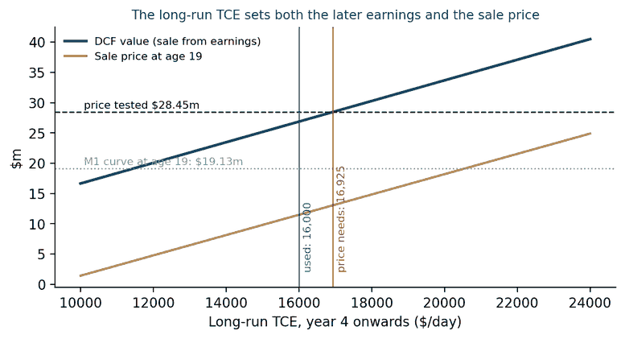

# Discounted Cash Flow Model (M2)

M1 answers *"what are ships like this selling for?"*. M2 asks *"what is this ship worth from the cash it can earn, and what is a price betting on?"*. It values the ship as the owner would: the cash it earns over a holding period, plus what it can be sold for at the end, discounted at the cost of the money tied up.

Case: Target Ship 1, an MR product tanker built in 2012 (age 14), base date **22 May 2026**. Every input was published on or before that date. The price tested ($28.45m, the ship's reported sale) was reported after the base date and is used only as the price being checked, never in a value.

## Model

Cash at each year end, before any loan (it belongs to everyone who funds the ship):

    earning days_t = earning days − dry-dock days in a survey year (every 5 years)
    cash_t         = TCE_t × earning days_t − opex × 365 × (1 + g)^(t−1) − survey cost − EU ETS
    value          = Σ cash_t ÷ (1 + r)^t  +  sale ÷ (1 + r)^5

Discount rate r = WACC, from the capital asset pricing model (CAPM) for equity and SOFR plus a loan margin for debt; no tax, because shipowners pay tonnage tax:

    cost of equity = 4.56% + 0.75 × 4.24% = 7.74%
    WACC           = 81.6% × 7.74% + 18.4% × 5.35% = 7.30%

| Input | Value | Source |
|---|---:|---|
| TCE year 1 | $30,000 a day | Broker weekly MR 1-year time-charter estimate, 13 May 2026 |
| TCE year 2 | $19,000 a day | Derived: 2 × the 2-year estimate ($24,500) − the 1-year estimate |
| TCE year 3 | $17,500 a day | Judgement: halfway between year 2 and the long-run TCE |
| Long-run TCE, year 4 on | $16,000 a day | Listed MR owner's median earnings 2015–2025 |
| Earning days | 360 (335 in a survey year) | Listed owner's on-hire rate, less an allowance for age |
| Opex | $7,654 a day, +3.3% a year | Listed owner's 2025 cost; growth 2023–2025 |
| Special survey | $1.8m, 25 days, April 2027, then every 5 years | Listed owners' estimates and actuals |
| Economic life, scrap | 25 years; 10,310 t × $460 = $4.74m | Depreciation policy; sister-design lightweight; demolition price 22 May |
| Discount rate | 7.30% | US 10-year yield, Damodaran beta and risk premium, SOFR + 1.80% |

All inputs with their sources: [`data/sample/dcf_inputs.json`](../../data/sample/dcf_inputs.json).

## Earnings in years 1–3

The broker quotes two charters starting now: one year at $30,000 a day, and two years at $24,500 a day. A two-year charter pays one flat rate in both years, so $24,500 is the **average** of year 1 and year 2, not the rate for year 2:

    (30,000 + year 2) ÷ 2 = 24,500   →   year 2 = 2 × 24,500 − 30,000 = 19,000

This is an approximation. The quotes are broker estimates, not traded forward prices; weighting each year by its discount factor would give about $18,600; and owners often accept a slightly lower daily rate for a longer, safer charter, so the true year-2 expectation may be a little higher. No three-year quote exists for a non-eco MR (the only one is for eco ships with scrubbers), so year 3 is set halfway between year 2 and the long-run TCE: $17,500, a stated judgement. Year 3 at $19,000 would add $0.44m.

An earlier version used $24,500 for both years 2 and 3, which overstated the value by $3.76m.

## The sale at the end

The holding period is five years, so the ship is sold at age 19. Two ways to price that sale:

| Sale price basis | Sale at age 19 | DCF value |
|---|---:|---:|
| **Earnings the ship has left (default)** | **$11.49m** | **$23.12m** |
| Today's market: the M1 age curve at age 19 | $19.13m | $28.49m |

**Why earnings is the default.** The cash forecast assumes earnings fall to $16,000 a day from year 4. A buyer at age 19 pays for the earnings then expected: $16,000 a day from age 20 to 25, less opex and one more special survey, plus scrap at 25, discounted to the sale date. The M1 curve gives what a 19-year-old sells for *today*, in a market paying about $30,000 a day for one year; using it would mix a weak-market cash forecast with a strong-market sale price. The two bases agree only if the long-run TCE is about $20,560 a day.

One consequence: with the earnings-based sale, the holding period does not change the value (every holding period from 1 to 11 years gives $23.12m). The ship is worth the cash it earns to age 25, whoever owns it. This is an algebraic consistency check of the model, not evidence about the market: in practice, selling at a different date changes costs, financing and the price a buyer will pay.

## Case: Target Ship 1, 22 May 2026

| Year | Age | TCE ($/day) | Earning days | Cash ($m) | Sale ($m) | Discount factor | Worth today ($m) |
|---:|---:|---:|---:|---:|---:|---:|---:|
| 1 | 15 | 30,000 | 335 | 5.456 | – | 0.9320 | 5.085 |
| 2 | 16 | 19,000 | 360 | 3.954 | – | 0.8686 | 3.434 |
| 3 | 17 | 17,500 | 360 | 3.318 | – | 0.8095 | 2.686 |
| 4 | 18 | 16,000 | 360 | 2.679 | – | 0.7544 | 2.021 |
| 5 | 19 | 16,000 | 360 | 2.576 | 11.490 | 0.7031 | 9.890 |
| **Total** | | | | | | | **23.115** |

| Result | Value |
|---|---:|
| **DCF value** (sale from earnings) | **$23.12m** |
| DCF value, sale at today's market | $28.49m |
| M1 market value (comparable sales) | $29.67m |
| Price tested | $28.45m |
| IRR at the price (before any loan; the sale price in it is itself a model result) | 1.0% a year, against 7.30% required |
| Average TCE assumed (weighted by what each day is worth today) | $19,988 a day |
| Implied TCE at the price (sale value held) | $23,690 a day |
| **Long-run TCE at which value = price** | **$19,131 a day** (model: $16,000) |

**Reading.** The market (M1, $29.67m) prices the ship a little above the price paid. The DCF puts the price well above value in use ($5.33m): the buyer earns 1.0% a year rather than 7.3%, unless MR earnings settle about $3,100 a day above the long-run assumption, close to the 2015–25 average. The price is level with the DCF when the sale is valued at today's market ($28.49m). So the price is consistent with a view that today's strong market lasts, not with a normal market. Neither DCF basis is certain to be right; they show what the price is betting on.

## Sensitivity chart: long-run earnings and the break-even

### How to read the sensitivity chart

**The question.** The model assumes the ship earns **$16,000 a day from age 18 until it is scrapped at 25**. Nobody knows if that is right. So the chart asks: *if the ship earns a different amount per day, what is it worth today?*

**The input it changes.** That daily amount is called **L** (long-run earnings, or long-run TCE). In the M2 workbook it is M2_Valuation_Draft_v5.xlsx, sheet Inputs, cell B14, the row "Long-run earnings per day (TCE), year 4 onwards" (value 16,000). In the code it is `tce_long_run` in `data/sample/dcf_inputs.json`. Everything else stays as in the base case.

**What is plotted.** The model is rerun for each L from $10,000 to $24,000 a day. Each run gives two results, one point on each line:

| Earnings per day from age 18 (L) | Sale price at age 19 (orange line) | Ship's worth today (dark line) |
|---:|---:|---:|
| $14,000 | $8.14m | $19.71m |
| **$16,000 (model)** | **$11.49m** | **$23.12m** |
| $18,000 | $14.84m | $26.52m |
| **$19,131 (break-even)** | $16.74m | **$28.45m = price paid** |
| $20,000 | $18.20m | $29.93m |

The two horizontal lines do not depend on L: the price actually paid ($28.45m, dashed) and today's market price of a 19-year-old ship from M1 ($19.13m, dotted, for comparison).

**The equations.** With r = 7.30% (the discount rate), opex = running cost, survey = $1.8m special survey at age 20, scrap = $4.74m at age 25:

Orange line, the sale price at age 19 (what the next owner pays for ages 20–25):

    S(L) = Σ (k = 1..6) [ L × days_k − opex_k − survey_k ] / (1 + r)^k  +  scrap / (1 + r)^6
           days = 335 at age 20 (survey year), 360 otherwise

Dark line, the ship's worth today:

    V(L) = Σ (t = 1..3) cash_t / (1 + r)^t            years 1–3 (ages 15–17): $11.21m, does not depend on L
         + Σ (t = 4..5) [ L × 360 − opex_t ] / (1 + r)^t   years 4–5 (ages 18–19)
         + S(L) / (1 + r)^5                           the sale, brought back 5 years (× 0.703)

**Why both lines rise, almost in parallel.** Each extra $1,000 a day raises the sale price by $1.68m (six more years of earnings for the next owner) and the worth today by $1.70m ($0.52m from years 4–5, plus $1.68m × 0.703 = $1.18m from the higher sale). The slopes are nearly equal, so the lines look parallel.

**Why the dark line sits about $11.6m above the orange line.** At L = $16,000: worth today $23.12m − sale price $11.49m = $11.63m. That gap is the cash from years 1–3 ($11.21m) plus years 4–5 ($3.83m), less what the sale price loses by arriving five years later ($11.49m − $8.08m = $3.41m). Years 1–3 do not change with L, so the gap stays between $11.5m and $11.8m across the chart.

**What it shows.** At the model's $16,000 a day the ship is worth $23.12m; the buyer paid $28.45m. The dark line reaches the price at **$19,131 a day** (the break-even). The price paid is justified only if the ship earns about $19,100 a day from age 18, not the $16,000 assumed.

The long-run TCE sets both the earnings from year 4 and the sale price. Each $1,000 a day moves the value by about $1.7m: from $20.6m at the 2015–21 average ($14,547) to $30.3m at the 2015–25 average ($20,205).

| Change, one at a time | DCF value ($m) | Change |
|---|---:|---:|
| Base case | 23.12 | – |
| Long-run TCE $14,547 (2015–21 average) | 20.64 | −2.48 |
| Long-run TCE $20,205 (2015–25 average) | 30.28 | +7.16 |
| Earnings −$1,000 a day in every year | 20.50 | −2.62 |
| Year 3 at $19,000 instead of $17,500 | 23.55 | +0.44 |
| Sale at today's market (M1 curve) | 28.49 | +5.37 |
| Discount rate +1 point | 22.11 | −1.01 |
| Debt share 60%, beta re-levered to 1.60 (WACC 7.75%) | 22.66 | −0.46 |
| Opex +10% | 20.73 | −2.39 |
| Survey cost $2.48m | 22.04 | −1.08 |
| EU ETS $0.5m a year (illustrative) | 19.42 | −3.69 |
| Commission 2.5% of hire, every year to age 25 (sale price included) | 21.92 | −1.19 |
| Economic life 22 years (scrapped at 22) | 20.63 | −2.48 |
| Economic life 28 years | 23.65 | +0.53 |

## Scenarios: bear, base and bull

The sensitivity table changes one input at a time. The scenarios move three together, as a weak or strong market would:

| Lever | Bear | Base | Bull | How it is set |
|---|---:|---:|---:|---|
| Earnings, every year of the hold | −25.4% | 0% | +26.3% | Listed owner's three lowest years 2015–25 ($11,936) and its 2015–25 average ($20,205), against the long-run TCE ($16,000) |
| Discount rate | 8.30% | 7.30% | 6.30% | ± 1 point |
| Sale price at the end | −11.4% | 0% | +11.4% | The M1 curve's range (± one standard deviation) at today's age |
| **Ship's worth today** | **$14.38m** | **$23.12m** | **$32.58m** | |
| Against the price paid ($28.45m) | −49.4% | −18.8% | +14.5% | |
| IRR if bought at the price | −9.4% | 1.0% | 10.9% | |

**Reading.** The price paid sits between the base and bull cases: it needs a market closer to strong than to normal. In the bear case the buyer loses money.

**Limit.** The sale price moves only by its own lever; it is not recalculated from the scenario earnings. Lower earnings would also lower the sale price, so the bear and bull values understate how far the value can move.

## Checks

- The Python code reproduces the M2 workbook to the last decimal shown; the workbook was recalculated in Excel with no error cells.
- Tests: published values, the bear / base / bull scenarios, year 2 derived from the two quotes, the sale on both bases, IRR, implied TCE, break-even long-run TCE, holding-period invariance for every hold from 1 to 11 years, rejection of a hold past age 25, commission over the whole life, the implied-TCE identity and the re-levered WACC (`tests/test_dcf.py`).

## Limitations

The main ones (full list in [limitations](../limitations.md)):

- **No FFA curve.** Years 1–3 use one broker's time-charter estimates as a stand-in for forward freight prices, which need a paid subscription. Year 2 is derived from two quotes and is approximate; year 3 is a judgement.
- **Long-run TCE is a judgement** from one listed owner's history, and it drives both the later earnings and the sale price.
- **Discount rate** uses a sector beta from eight US firms, not tanker owners, and a sector debt share of 18%, against 50–65% on a typical ship loan. The re-levering test uses the no-tax formula, which at the base debt share gives a beta of 0.78 rather than the 0.75 used (−$0.13m). No tax is charged: shipowners pay tonnage tax, assumed immaterial.
- **Nominal and flat figures are mixed:** opex grows 3.3% a year while TCE and the sale price are flat, which leans the value low.
- **Gross hire:** commissions (1.25–5%) are not deducted.
- **Lightweight** is a sister-design proxy; ±500 t moves scrap by about $0.23m.
- **One case ship, one date.** The model is shown on one MR tanker on 22 May 2026.

## Files

- [`src/shipping_valuation/models/dcf.py`](../../src/shipping_valuation/models/dcf.py): the model.
- [`examples/run_dcf.py`](../../examples/run_dcf.py): runs the case step by step and draws the figure.
- [`tests/test_dcf.py`](../../tests/test_dcf.py): checks.
